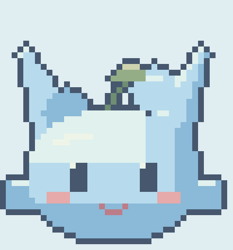
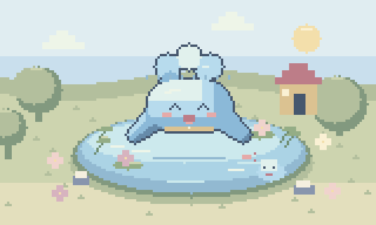

# あわもんとなかまたち

**家事で、この子を育てる。「あとで洗おう」を、「この子に会いたい」に。**

食器洗い・食材活用・料理・洗濯の「できた！」が、ピクセルアートの仲間と小さな世界を育てる、スマートフォン向けWebアプリです。



**JPHACKS 2026 東京A／チーム tka_2616**

### デモ動画・作品情報

**デモ動画：URL準備中。**

- [発表スライド（PDF・4枚）](deliverables/pitch/kurashimon-90sec-revised.pdf) ／ [アニメーション入りPowerPoint](deliverables/pitch/kurashimon-90sec-revised.pptx)
- [ローカルで試す](#動かしてみる) ／ [実装・検証状況](#verification) ／ [独自機能とコード](#独自技術)
- 現在は個人用の試作です。一般公開の体験URLはありません。開発者のスマホでは、Tailscale経由のHTTPS接続で利用しています。

## 製品概要

### 背景(製品開発のきっかけ、課題等）

食器洗いなどの家事は、必要だと分かっていても「あとでやろう」と後回しにしがちです。終えても、すぐ次の洗い物が生まれる。日々の小さながんばりは、形として残りにくいと感じました。

想定するユーザーは、一人暮らしの学生など、家事を自分で担いながら、取りかかるきっかけを欲しい人です。家事の完了を、キャラクターが喜び、姿や景色が変わる体験に結び付けます。「やらなければ」だけでなく、「この子を育てたい」という楽しみをつくることを目指しました。

### 製品説明（具体的な製品の説明）

1. **家事の前に撮る。** スマホで作業前の写真を撮影します。あわもんでは、YOLOEが見つけた食器に枠・名前・個数を表示します。
2. **できたら、もう一枚。** AI判定に同意している場合、GPTが前後の写真を比較し、作業完了に整合する変化を確認します。
3. **「できた！」で育つ。** 完了を記録すると仲間が喜び、ごほうびがたまると姿と世界が成長。進化時には大きなアニメーションと音で祝います。

写真で判断しきれない場合やAIを使わない場合も、自分で完了を記録できます。途中で閉じても作業を再開できます。

| なかま | 育つ家事 | 撮影するもの | 育つ世界 |
| --- | --- | --- | --- |
| あわもん | 食器洗い | 洗う前・洗い終わった後の様子 | 池 |
| べじもん | 食材活用 | 使う食材・使った後の料理や調理の様子 | キッチン菜園 |
| なべもん | 料理 | 材料や準備・できあがった料理 | 台所 |
| ひなたもん | 洗濯・干す | 洗う衣類・干した洗濯物 | ベランダ |

右上の「なかま」で切り替えます。記録と成長はキャラごとに独立しています。

### 特長

#### 1. がんばりが「姿」と「景色」に残る

4キャラそれぞれに5段階の姿、7種類の動き、成長する背景があります。レベルが上がると、耳・尾・翼・屋台などシルエットも変化します。タップで喜び、画面に戻ると手を振り、昼はときどき遊び、夜は眠ります。



*アプリで使用する描画エンジンの出力。家事を重ねると、姿と世界が育ちます。*

#### 2. 写真で達成を確認し、迷うときは本人が決められる

YOLOEは「食器を見つける」、GPTは「前後の変化を確認する」を担当します。検出結果はプレビュー用で、GPTには元の前後画像を渡します。AIが不確かなときは、誤って失敗扱いせず、本人の完了操作につなげます。自己申告でも同じごほうびを受け取れます。

#### 3. 休んでも、戻ってこられる

外食や旅行で家事がない日もあります。放置による衰弱やポイント減少は設けず、積み重ねた成長を残します。音は初期OFF。日常の負担を増やさず、自分のペースで使える相棒を目指しています。

### 解決出来ること

- 家事を始めるきっかけとして、仲間に会う・育てる楽しみを用意します。
- 達成メッセージ、反応、進化によって、家事を終えた直後にがんばりを実感できます。
- 「おもいでノート」に完了を残し、目に見えにくかった日々の積み重ねを振り返れます。

家事の実行頻度や食品ロス削減への効果は、まだ定量評価していません。現在は、撮影から記録・育成までの一連の体験を動かせる段階です。

### 今後の展望

- 実際の生活で継続利用してもらい、撮影の負担、家事に取りかかりやすくなるか、継続率を検証する。
- 食器を片づけた場合や料理の見た目が大きく変わる場合など、写真判定の苦手な条件を集めて改善する。
- 最高レベル以降も楽しめる、累計達成による池の飾り・着せ替えを追加する。
- 食材検出への展開と、認証・ユーザーごとのデータ分離を実装し、他の人も使える環境にする。

上記は今後の計画で、現在の実装には含まれません。

### 注力したこと（こだわり等）

- **スマホで撮って使う体験。** 水色を中心とした柔らかいピクセルUIに統一。小さい画面でのシーンと見出しの重なりを修正し、写真処理中はキャラの待機演出を表示します。
- **「判定結果」より「できた！」を届ける。** 根拠の長文表示を見直し、成功時は大きな文字と色で達成を祝う画面に変更しました。
- **動きが普段の操作につながる。** 開発用の再生ボタンだけでなく、タップ・画面復帰・家事完了・時刻に合わせて動きが変わります。
- **AIに任せる範囲を決める。** 食器の消失だけで洗浄を断定せず、写真の外にある事情は本人が補えます。画像を外部へ送るのは同意時のみです。

## 開発技術

### 活用した技術

#### API・データ

- OpenAI Responses API：前後2枚の画像入力、JSON Schemaによる構造化した判定結果。モデル名は環境変数で指定します。
- YOLOE11s-seg-pfの学習済みモデル：ローカルCPUで食器を検出。モデル自体の学習・開発は行っていません。
- Kenney Interface Sounds、効果音ラボ、VOICEVOX:ずんだもん：操作音・反応音・「おかえり」「やったね」の短い声。[出典・クレジット](frontend/public/audio/README.md)

#### フレームワーク・ライブラリ・モジュール

- フロントエンド：Next.js / React / TypeScript / Canvas 2D / Web Audio
- バックエンド：FastAPI / Python / Pillow / HTTPX
- 保存：SQLite（キャラ別の記録・ごほうび・進化）
- 物体検出：Ultralytics / PyTorch（CPU）
- 開発支援：Codex、プロジェクト内のpixel-animsスキル。生成・編集したコードと素材はリポジトリで管理しています。

#### デバイス

- カメラ付きスマートフォン：撮影・操作・育成。開発者のPixel 8aで動作確認。
- PC：Next.js・FastAPI・YOLOEの実行。YOLOEの静止画推論にGPUは必須ではありません。
- スマホと開発PCの接続：Tailscale Serveによる限定HTTPS共有。

### 独自技術

#### ハッカソンで開発した独自機能・技術

既存の認識モデル・ライブラリを組み合わせ、その結果を家事の記録とキャラクターの成長につなぐ体験を実装しました。特に力を入れた変更は、以下のファイルとコミットで確認できます。

| 実装したこと | コード | コミット |
| --- | --- | --- |
| 4種類の家事と独立した育成・記録 | [キャラ定義](frontend/src/lib/characters.ts)、[タスク別判定条件](backend/app/tasks.py) | `3229794` |
| 進化のシルエット・動作バリエーション | [シーン生成](art/scripts/build_scene.mjs)、[スプライト書き出し](art/scripts/export_sprites.py) | `00cdfc1` |
| 大きな進化演出と音声・効果音 | [進化演出](frontend/src/components/EvolutionCelebration.tsx)、[音制御](frontend/src/hooks/usePetSound.ts) | `786fb3a`、`8383391` |
| 写真処理中の待機演出と復帰導線 | [待機画面](frontend/src/components/TaskWaiting.tsx)、[撮影フロー](frontend/src/app/page.tsx) | `7793a9c` |
| YOLOEの食器検出を撮影プレビューに統合 | [CPU推論](backend/app/detection.py)、[枠・名前の表示](frontend/src/components/DishDetection.tsx) | `55dfe8f` |
| 画面復帰・時刻・完了に応じた自動モーション | [動作制御](frontend/src/hooks/usePetBehavior.ts)、[動作テスト](frontend/tests/usePetBehavior.test.mjs) | `f99720a` |

**事前開発は行っていません。** 本プロダクトの実装・キャラクター制作はHack Day期間中に行いました。最初のコミット `c340974` は、それまでの当日作業をまとめて記録したものです。上記の変更は2026年10月18日（日本時間）のコミットから確認できます。外部ライブラリ・学習済みモデル・音源は上記の提供元のものを利用しています。

## 動かしてみる

Node.js 22以上、Python 3.12以上、[uv](https://docs.astral.sh/uv/)を用意します。

```bash
./scripts/setup.sh
./scripts/dev.sh
```

http://127.0.0.1:3000 を開きます。**APIキーなしでも、前写真を選ぶ → 作業 → 自分で完了を記録 → 育成**を試せます。PCでは写真ファイルを選択できます。音は「♪ 音 OFF」を押してONにします。

- 進化をすぐ確認する：「大進化デモを見る」。記録やポイントを変えずに演出を再生します。
- 全形態・動作を確認する：「実験室」。これは開発用プレビューです。
- AI比較を使う：`backend/.env.example` を `backend/.env` にコピーし、`OPENAI_API_KEY` と画像入力・構造化出力対応の `OPENAI_VISION_MODEL` を設定して再起動します。
- 食器の検出枠を出す：`./scripts/setup-detection.sh` を実行して再起動します。モデルとCPU用依存パッケージをダウンロードします。

詳しい設定、スマホ接続、データ保存、テスト手順は [開発・実行ガイド](docs/RUNNING.md) にまとめています。

<a id="verification"></a>

## 実装・検証状況

提出用のコミットを別ディレクトリにcloneし、APIキー・DB・モデルのない状態からsetup、本番ビルド、HTTP起動、自己申告による10ポイント保存まで確認しました（同一PC上）。

| 項目 | 現在の状況 |
| --- | --- |
| 撮影・記録・成長 | 実装済み。4キャラの独立した保存、途中再開、自己申告をサポート |
| GPT写真比較 | 実装済み。開発者が実APIでの判定を確認。体系的な精度評価は未実施 |
| YOLOE食器検出 | 実装済み。公開サンプルと開発者の写真で動作確認。食材検出は未実装 |
| スマホ・音 | 開発者のスマホでHTTPS接続・操作・音声再生を確認。複数端末の網羅検証は未実施 |
| 自動テスト | バックエンド38件、フロントの音・動作・表示領域18件を確認済み。詳細は[検証記録](docs/VERIFICATION.md) |
| 一般公開・複数ユーザー | 未対応。現在は認証・ユーザー分離のない単一ユーザー用ローカル試作 |

写真の見た目から衛生・食品の安全性や食品ロス削減量を保証するものではありません。YOLOEの物体検出とGPTの比較結果も、現実の作業の証明にはなりません。

## 関連資料

- [設計](docs/DESIGN.md) ／ [仲間の仕様](docs/COMPANIONS.md) ／ [ピクセルアート制作](docs/PIXEL_DESIGN.md)
- [音源の出典・利用条件](frontend/public/audio/README.md)
- YOLOEの利用条件は [Ultralyticsのライセンス](https://www.ultralytics.com/license) を参照。外部の音源・モデル等の権利はそれぞれの提供元に帰属します。

コードのライセンスは提出先に付属する [LICENSE](LICENSE) を参照してください。外部素材・モデルの利用条件はこのライセンスで置き換わりません。
